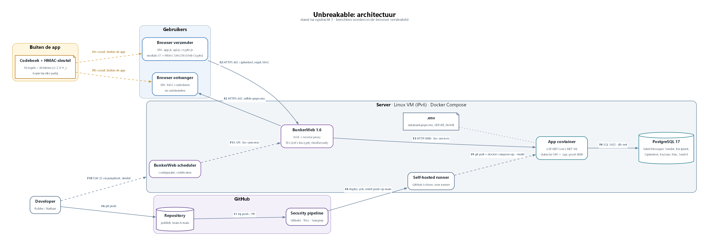
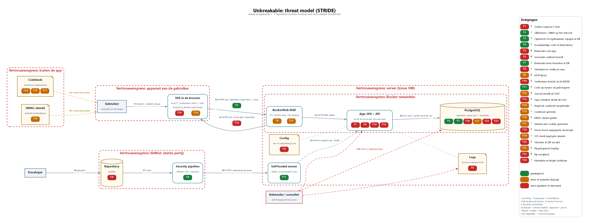

# Threat model van Unbreakable

**Team:** Robbe Augustyns en Nathan Cordier · **Stand:** na opdracht 3 (cryptografie)

Dit document beschrijft de app zoals ze nu draait. Maatregelen die nog niet gebouwd zijn, zoals Keycloak, OPA en OpenBao, staan bij de dreigingen met de opdracht waarin ze komen.

De T-nummers (dreigingen) en F-nummers (flows) zijn dezelfde in de tekst en op beide afbeeldingen.

---

## 1. Architectuur

### Componenten

| Component | Wat het doet |
|---|---|
| Browser van de verzender | Voert de SPA uit. Versleutelt het bericht in modulo 37 en berekent de HMAC SHA256 (`crypto.js`). |
| Browser van de ontvanger | Controleert de MAC met `crypto.subtle.verify` en ontsleutelt pas daarna. |
| Codeboek en HMAC-sleutel | 50 regels van 40 tekens (A-Z, 0-9, `_`) en één aparte HMAC-sleutel. Elke partij heeft een kopie buiten de app. |
| BunkerWeb 1.6 | WAF en reverse proxy. Enige container die van buitenaf bereikbaar is (poort 80 en 443). Regelt TLS met Let's Encrypt en ModSecurity. |
| BunkerWeb scheduler | Beheert de configuratie en de certificaten van BunkerWeb. |
| App container | ASP.NET Core op .NET 10. Levert de statische SPA en de API op poort 8080, alleen intern bereikbaar. |
| PostgreSQL 17 | Tabel `Messages` met `Sender`, `Recipient`, `Ciphertext`, `KeyLine`, `Mac` en `SentAt`. |
| `.env` | Databankgegevens en `SERVER_NAME`, alleen op de server. |
| Self-hosted runner | GitHub Actions-runner op de server, onder de gebruiker `runner`. Rolt de app uit na een geslaagde pipeline. |
| GitHub | Publieke repository en de security pipeline (Gitleaks, Trivy, Semgrep). |

### Flows

| Flow | Van → naar | Protocol | Wat gaat er over | Authenticatie |
|---|---|---|---|---|
| F1 | Gebruiker → SPA | lokaal in de browser | bericht, sleutel, HMAC-sleutel | geen |
| F2 | Browser ↔ BunkerWeb | HTTPS 443 | SPA-code; ciphertext, regelnummer, MAC en `X-User` | geen, alleen een naam in `X-User` |
| F3 | BunkerWeb → App | HTTP 8080, netwerk `bw-services` | zelfde als F2 | geen |
| F4 | App → PostgreSQL | SQL over TCP 5432, netwerk `db-net` | rijen uit `Messages` | wachtwoord uit `.env` |
| F5 | Verzender ↔ ontvanger | buiten de app | codeboek en HMAC-sleutel | persoonlijk contact |
| F6 | Developer → GitHub | git push | broncode | GitHub-account |
| F7 | Repository → pipeline | GitHub Actions | broncode | binnen GitHub |
| F8 | GitHub → runner | HTTPS 443, uitgaand vanaf de server | deploy-job, alleen bij een push op `main` | registratietoken van de runner |
| F9 | Runner → Docker | lokale socket | `git pull` en `docker compose up -d --build` | gebruiker `runner` in de groep `docker` |
| F10 | Developer of beheerder → server | SSH 22 via een IPv4-jumphost | beheer | SSH-sleutel |
| F11 | Scheduler → BunkerWeb | API, netwerk `bw-universe` | configuratie en certificaten | IP-whitelist |

### Vertrouwensgrenzen

- **Apparaat van de gebruiker.** Hier staat het bericht in leesbare vorm en hier worden de sleutels ingetypt. Wat de SPA controleert, kan een gebruiker omzeilen. Alleen de MAC-controle beschermt de ontvanger, en die gebeurt ook in de browser.
- **Buiten de app.** Het codeboek en de HMAC-sleutel komen nooit op de server en nooit in git. `codeboek*` staat in `.gitignore`.
- **Server.** De beheerder heeft volledige toegang tot de containers, de databank en de logs.
- **Docker-netwerken.** Alleen BunkerWeb staat open naar buiten. De app en de databank zitten in aparte interne netwerken.
- **GitHub.** Derde partij. De repository is publiek.

---

## 2. Versleuteling en sleutels

1. Verzender en ontvanger maken vooraf een codeboek met `tr -dc 'A-Z0-9_' < /dev/urandom | fold -w 40 | head -n 50 | nl` en een HMAC-sleutel, bijvoorbeeld met `openssl rand -hex 32`. Ze wisselen beide uit buiten de app (F5). Ze spreken af wie de even en wie de oneven regels gebruikt.
2. De verzender typt het bericht, een ongebruikt regelnummer, de sleutel van die regel en de HMAC-sleutel in (F1).
3. De browser rekent per teken `(bericht + sleutel) mod 37` en berekent `HMAC-SHA256(HMAC-sleutel, "regelnummer:ciphertext")`.
4. Alleen de ontvanger, de ciphertext, het regelnummer en de MAC gaan naar de API (F2, F3) en de databank (F4).
5. De ontvanger zoekt het regelnummer op in het eigen codeboek en typt de sleutel en de HMAC-sleutel in. De browser controleert eerst de MAC met `crypto.subtle.verify`. Alleen bij een geldige MAC rekent hij `(ciphertext - sleutel) mod 37`.

De MAC is nodig omdat een one-time pad alleen vertrouwelijkheid geeft, geen integriteit. Wie het bericht kent, kan de ciphertext zo aanpassen dat de ontvanger een ander bericht leest. Het regelnummer zit mee in de MAC, zodat ook een gewijzigd nummer opvalt.

---

## 3. Data stores

| Data store | Wat zit erin | Versleuteld? |
|---|---|---|
| Codeboek (bij elke partij) | sleutels per regelnummer | nee, tenzij de partij het zelf beschermt |
| HMAC-sleutel (bij elke partij) | gedeelde sleutel voor de MAC | nee, tenzij de partij ze zelf beschermt |
| Geheugen van de browser | bericht en sleutels, alleen tijdens versturen of lezen | nee |
| `localStorage` van de browser | alleen de gekozen naam | nee |
| PostgreSQL: `Ciphertext` | het bericht | ja, one-time pad in modulo 37 |
| PostgreSQL: `Mac` | HMAC SHA256 | niet nodig, zonder sleutel niet na te maken |
| PostgreSQL: `KeyLine`, `Sender`, `Recipient`, `SentAt` | metadata | nee |
| `.env` op de server | databankgegevens | nee (opdracht 6) |
| `app/appsettings.json` in de repo | databankwachtwoord en API-key van de starter app | nee, en publiek (T8) |
| Logs van Docker en BunkerWeb, volume `bw-storage` | verzoeken, IP-adressen, certificaten | nee |
| GitHub repository | broncode, geen codeboek | nee, publiek |

### Waar staan de leesbare berichten?

Alleen in de browser van de verzender (in het invoerveld, tijdens het versleutelen) en van de ontvanger (op het scherm, na het ontsleutelen). De app bewaart ze nergens en stuurt ze niet door.

### Wat kan de beheerder van de server nog?

| Ziet niet | Ziet wel | Kan wel |
|---|---|---|
| de inhoud van een bericht | wie met wie communiceert, wanneer en hoe vaak | een rij wijzigen: opgemerkt bij ciphertext en regelnummer (T3), niet bij de afzender (T20) |
| de sleutels uit het codeboek | de lengte van elk bericht | een rij kopiëren (T21) of verwijderen (T22) |
| de HMAC-sleutel | welke regel gebruikt is, en dus ook hergebruik van een regel (T14) | de JavaScript aanpassen die naar de browser gaat en zo sleutels stelen (T18) |
| | IP-adressen in de logs | logs wissen (T5) |

---

## 4. Threat model

Elke badge op de afbeelding hangt aan de component of flow die de dreiging raakt. De kleur geeft de status:

- **Groen:** gemitigeerd.
- **Oranje:** deels gemitigeerd, of afhankelijk van een manuele afspraak.
- **Rood:** open, gepland voor een volgende opdracht of aanvaard.

### Dreigingen

Formulering: een A doet B op C door D, wat leidt tot E.

| # | STRIDE | Waar | Dreiging | Maatregel | Opdracht | Status |
|---|---|---|---|---|---|---|
| T1 | Spoofing | App, F2 | Een gebruiker zet de naam van iemand anders in de header `X-User`, doordat er geen authenticatie is. Hij kan dan andermans berichten opvragen en verwijderen en berichten sturen onder een andere naam. De inhoud blijft onleesbaar zonder codeboek. | Inloggen via een identity provider (Keycloak), tokens die de API valideert | 4 | Open |
| T2 | Information disclosure | F2 | Een aanvaller luistert het verkeer af of doet zich voor als de server, doordat er geen TLS zou zijn. Zo zou hij berichten en code kunnen lezen of aanpassen. | HTTPS met Let's Encrypt via BunkerWeb; poort 8080 is extern dicht. Sinds opdracht 3 gaat er ook alleen ciphertext over. | 2 | Gemitigeerd |
| T3 | Tampering | PostgreSQL | Een aanvaller met toegang tot de databank wijzigt de ciphertext of het regelnummer, doordat de databank zelf niets controleert. De ontvanger zou dan een vervalst bericht lezen. | HMAC SHA256 over regelnummer en ciphertext, gecontroleerd met `verify` vóór het ontsleutelen | 3 | Gemitigeerd |
| T4 | Tampering | Pipeline | Een aanvaller verstopt kwaadaardige code in een dependency, of er komt onveilige code in de repo, doordat niets dat controleert. Dat kan leiden tot overname van de app. | Gitleaks, Trivy en Semgrep in de pipeline; deploy alleen na geslaagde scans. CVE-2024-21907 (Newtonsoft.Json 12.0.1) is als baseline aanvaard in `.trivyignore`. | 2 | Gemitigeerd |
| T5 | Repudiation | Logs | Een beheerder wist of wijzigt logs, doordat ze alleen lokaal op dezelfde server staan. Zo kan hij zijn acties ontkennen. | Centrale, append-only logging | 4 en 6 | Open |
| T6 | Repudiation | App | Een verzender ontkent een bericht te hebben gestuurd, doordat beide partijen dezelfde HMAC-sleutel hebben en dus allebei een geldige MAC kunnen maken. Er is dan geen bewijs. | Digitale handtekening met een private sleutel van de verzender. HMAC geeft integriteit, geen onweerlegbaarheid. | later | Open |
| T7 | Information disclosure | PostgreSQL | Een beheerder of aanvaller met toegang tot de databank leest alle berichten, doordat ze onversleuteld bewaard worden. Dat leidt tot verlies van vertrouwelijkheid. | One-time pad in modulo 37 in de browser; de server krijgt nooit bericht of sleutel. Geldt zolang T15 en T18 niet gebeuren. | 3 | Gemitigeerd |
| T8 | Information disclosure | Config, repository | Iemand leest het databankwachtwoord en een API-key in `app/appsettings.json`, doordat die in de publieke repo staan, en de gegevens in `.env`, doordat dat bestand leesbaar op de server staat. Dat kan leiden tot toegang tot de databank. | Geheimen in een secrets manager (OpenBao); geheimen uit de repo en de git-historiek halen en vervangen | 6 | Open |
| T9 | Denial of service | BunkerWeb, F2 | Een aanvaller overspoelt de app met requests, doordat er geen limiet is. De app wordt dan onbeschikbaar. | Rate limiting van BunkerWeb met de standaardinstellingen; `restart: unless-stopped` | 2 | Deels |
| T10 | Elevation of privilege | App | Een gebruiker vraagt of verwijdert een bericht met het id van iemand anders via `/api/messages/{id}`, doordat er geen autorisatie per bericht is. Lezen geeft alleen ciphertext, verwijderen lukt wel. | Autorisatie per bericht (OPA) | 5 | Open |
| T11 | Elevation of privilege | Runner | Een aanvaller laat via een pull request code uitvoeren op de self-hosted runner, doordat de repo publiek is. Dat leidt tot code op de server. | Deploy-job alleen bij een push op `main` en alleen na geslaagde scans; runner onder een eigen gebruiker. De gebruiker zit wel in de groep `docker`. | 2 | Gemitigeerd |
| T12 | Elevation of privilege | BunkerWeb | Een aanvaller omzeilt ModSecurity met een verdoken payload, doordat een WAF op patronen werkt. De aanval bereikt dan de app. | Defense in depth: data uit de API wordt geëscaped. De zoekfunctie met SQL-injectie is in opdracht 3 verwijderd. | 2 en 3 | Deels |
| T13 | Elevation of privilege | App container | Een aanvaller die code uitvoert in de app krijgt rootrechten in de container, doordat de `Dockerfile` geen `USER` instelt. Dat maakt een uitbraak naar de host makkelijker. | `USER` zonder rootrechten in de `Dockerfile`. Staat als baseline in `.semgrepignore`. | nog te plannen | Open |
| T14 | Information disclosure | Codeboek | Een gebruiker versleutelt twee berichten met dezelfde regel, doordat de app regels niet bijhoudt. Dan lekt het verschil tussen beide berichten. | Gebruikte regels doorstrepen; afspraak over even en oneven regels | 3 | Manueel |
| T15 | Information disclosure | Codeboek | Een aanvaller steelt een kopie van het codeboek, doordat het onbeschermd bewaard wordt. Hij kan dan alle berichten lezen die ermee versleuteld zijn. | Offline en veilig bewaren; gebruikte regels vernietigen; nooit op de server of in git | 3 | Manueel |
| T16 | Spoofing | HMAC-sleutel | Een aanvaller die de HMAC-sleutel kent, maakt een geldige MAC over een aangepaste ciphertext, doordat dezelfde sleutel hergebruikt wordt. Een vervalst bericht doorstaat dan de controle. | Veilig bewaren; bij een vermoeden van een lek een nieuwe sleutel uitwisselen | 3 | Manueel |
| T17 | Information disclosure | Codeboek | Een aanvaller voorspelt sleutels, doordat ze met een zwakke generator gemaakt zijn, zoals `Math.random`. Hij kan dan berichten ontsleutelen. | Sleutels maken met `/dev/urandom` | 3 | Manueel |
| T18 | Tampering | App, F2, SPA | Een beheerder of een aanvaller op de server past de JavaScript aan, doordat de browser de code van de server uitvoert. Zo kan hij berichten en sleutels stelen bij het intypen. | Toegang tot de server en de pipeline beperken. Een echte oplossing vraagt code die niet van dezelfde server komt, zoals een aparte client. | later | Open |
| T19 | Information disclosure | SPA | Een aanvaller injecteert script in de SPA, doordat data uit de API in de pagina komt. Het script steelt dan sleutels uit de invoervelden. | Alle data uit de API via `escapeHtml` of `textContent`; de `.html()`-aanroep van de zoekfunctie is weg. Een strikte Content Security Policy kan nog. | 3 | Deels |
| T20 | Spoofing | PostgreSQL, App | Een aanvaller wijzigt de afzender van een rij, doordat de MAC de afzender niet dekt. De ontvanger ziet dan een bericht met een valse afzender. Een nieuw bericht zonder HMAC-sleutel valt wel op. | Authenticatie (opdracht 4); afzender en ontvanger mee in de MAC opnemen | 4 | Open |
| T21 | Spoofing | PostgreSQL | Een aanvaller kopieert een bestaande rij, doordat de MAC van een kopie geldig blijft. Een oud bericht wordt dan opnieuw afgeleverd. | Regelnummer zit in de MAC; de ontvanger ziet in het codeboek dat de regel al gebruikt is | 3 | Manueel |
| T22 | Denial of service | PostgreSQL | Een beheerder of een gebruiker (via T10) verwijdert een rij, doordat een MAC alleen bestaande berichten beschermt. Het bericht komt dan nooit aan. | Regelnummers opvolgen tussen beide partijen: een ontbrekend nummer valt op | later | Open |
| T23 | Information disclosure | PostgreSQL | Een beheerder analyseert de metadata, doordat afzender, ontvanger, tijdstip, regelnummer en lengte niet versleuteld zijn. Hij leert zo wie met wie praat en hoeveel. | Geen in deze opdracht | - | Aanvaard |
