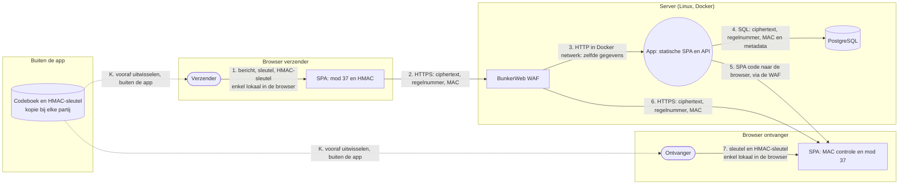

# Threat model van Unbreakable (stand na opdracht 3)

Dit model vult `ThreatModel.png` aan met de versleuteling en het doorgeven van de sleutels. Op die afbeelding staan nog AES-256-GCM en ECDSA als maatregel voor opdracht 3. In de implementatie zijn dat een one-time pad in modulo 37 en HMAC SHA256 geworden. Dit document is daarvoor de geldige versie.

## Architectuur

Nieuwe vertrouwensgrens: de sleutels gaan via een apart kanaal buiten de app. De server komt ze nooit tegen. De SPA code komt wel van de server, dus de browser moet de server nog altijd vertrouwen voor de code die hij uitvoert (zie T13).

## Waar staan de plain-text berichten?

Enkel in de browser van de verzender (invoerveld, tijdens het versleutelen) en in de browser van de ontvanger (scherm, na het ontsleutelen). De app bewaart ze daar niet en stuurt ze niet door.

## Data stores

| Data store | Wat zit erin | Versleuteld? |
|---|---|---|
| Codeboek (bij elke partij, buiten de app) | Sleutels per regelnummer | Nee, tenzij de partij het zelf beschermt |
| HMAC-sleutel (bij elke partij, buiten de app) | Gedeelde sleutel voor de MAC | Nee, tenzij de partij ze zelf beschermt |
| Geheugen van de browser | Bericht en sleutels, enkel tijdens de actie | Nee |
| `localStorage` van de browser | Enkel de gekozen naam | Nee |
| PostgreSQL | Ciphertext | Ja, one-time pad in modulo 37 |
| PostgreSQL | MAC | Nee, maar zonder HMAC-sleutel niet na te maken |
| PostgreSQL | Regelnummer, afzender, ontvanger, tijdstip | Nee |
| App container | Geen opslag, verwerkt ciphertext en metadata | Enkel de ciphertext |
| BunkerWeb logs en `bw-storage` | Verzoeken, IP-adressen, TLS materiaal | Nee |
| `.env` op de server | Databankgegevens | Nee (opdracht 6) |
| GitHub repository | Broncode, geen codeboek (`codeboek*` staat in `.gitignore`) | Nee |

## Wat kan de beheerder van de server nog zien en doen?

**Ziet niet:** de inhoud van een bericht, de sleutels en de HMAC-sleutel.

**Ziet wel:**

- wie met wie communiceert, wanneer en hoe vaak
- de lengte van elk bericht, want de ciphertext is even lang als het bericht
- welke regel uit het codeboek gebruikt is, en dus ook of een regel twee keer gebruikt is
- de IP-adressen in de logs

**Kan wel:**

- een rij wijzigen: de ontvanger merkt dat bij de ciphertext en het regelnummer, niet bij afzender, ontvanger of tijdstip
- een rij verwijderen of kopiëren
- de JavaScript aanpassen die naar de browser gaat (T13)

## Dreigingen

Formulering: een A doet B op C door D, wat leidt tot E. T1 tot T10 komen uit opdracht 1. Hier staan de dreigingen die opdracht 3 wijzigt of toevoegt.

| # | STRIDE | Dreiging | Maatregel | Status |
|---|---|---|---|---|
| T3 | Tampering | Een aanvaller met toegang tot de databank wijzigt de ciphertext of het regelnummer, doordat de databank niets controleert, wat leidt tot een vervalst bericht | HMAC SHA256 over regelnummer en ciphertext, gecontroleerd in de browser vóór het ontsleutelen | Opgelost in opdracht 3 |
| T6 | Repudiation | Een verzender ontkent een bericht, doordat beide partijen dezelfde HMAC-sleutel hebben en dus allebei een geldige MAC kunnen maken, wat leidt tot discussie zonder bewijs | Digitale handtekening | Niet opgelost: HMAC geeft integriteit, geen onweerlegbaarheid |
| T7 | Information disclosure | Een beheerder leest berichten in de databank, doordat hij er volledige toegang toe heeft, wat leidt tot verlies van vertrouwelijkheid | Versleuteling in de browser, enkel ciphertext op de server | Opgelost in opdracht 3, zolang T13 niet gebeurt |
| T11 | Information disclosure | Een gebruiker versleutelt twee berichten met dezelfde regel, doordat de app regels niet bijhoudt, wat leidt tot het lekken van het verschil tussen beide berichten | Gebruikte regels doorstrepen, afspraak even en oneven regels | Manuele afspraak, restrisico blijft |
| T12 | Information disclosure | Een aanvaller steelt een kopie van het codeboek, doordat het onbeschermd bewaard wordt, wat leidt tot het lezen van alle berichten die ermee versleuteld zijn | Veilig bewaren, gebruikte regels vernietigen, nooit op de server of in git | Manuele afspraak, restrisico blijft |
| T13 | Tampering | Een beheerder of aanvaller op de server past de JavaScript aan, doordat de browser de code van de server uitvoert, wat leidt tot het stelen van berichten en sleutels bij het intypen | Toegang tot server en pipeline beperken | Niet opgelost: grootste restrisico van versleuteling in een webapp |
| T14 | Spoofing | Een aanvaller wijzigt de afzender van een rij of zet een andere naam in `X-User`, doordat de MAC de afzender niet dekt en er geen authenticatie is, wat leidt tot een bericht met een valse afzender | Authenticatie in opdracht 4 | Open: een nieuw bericht zonder HMAC-sleutel valt wel op door de MAC |
| T15 | Spoofing | Een aanvaller kopieert een bestaande rij, doordat de MAC van een kopie geldig blijft, wat leidt tot het opnieuw afleveren van een oud bericht | Het regelnummer zit in de MAC, en de ontvanger ziet in het codeboek dat de regel al gebruikt is | Manuele controle door de ontvanger |
| T16 | Denial of service | Een beheerder of aanvaller verwijdert een rij, doordat een MAC enkel bestaande berichten beschermt, wat leidt tot een bericht dat nooit aankomt | Regelnummers opvolgen tussen beide partijen | Manuele controle, geen volledige oplossing |
| T17 | Information disclosure | Een beheerder analyseert de metadata in de databank, doordat afzender, ontvanger, tijdstip en lengte niet versleuteld zijn, wat leidt tot inzicht in wie met wie praat | Geen in deze opdracht | Geaccepteerd restrisico |
| T18 | Spoofing | Een aanvaller die de HMAC-sleutel bemachtigt, maakt een geldige MAC, doordat dezelfde sleutel hergebruikt wordt, wat leidt tot vervalste berichten die de controle doorstaan | Veilig bewaren, bij een vermoeden van lek een nieuwe sleutel uitwisselen | Manuele afspraak |
| T19 | Information disclosure | Een aanvaller voorspelt sleutels, doordat ze met een zwakke generator gemaakt zijn, wat leidt tot het ontsleutelen van berichten | Sleutels maken met `/dev/urandom`, niet met `Math.random` | Afspraak bij het maken van het codeboek |
| T20 | Information disclosure | Een aanvaller injecteert script in de SPA, doordat gegevens uit de API in de pagina komen, wat leidt tot het stelen van sleutels uit de invoervelden | Gegevens uit de API escapen, kwetsbare zoekfunctie verwijderd | Verkleind, Content Security Policy kan nog |
